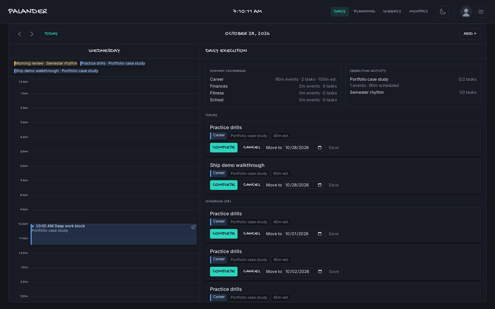

# Palander

Palander is a personal **execution planner**: organize work by **Domains** and **Objectives**, run your day with **Tasks** and calendar **Events**, and review progress in **Planning** without turning the app into a general-purpose notes vault.

**Status:** Active development ([`CHANGELOG.md`](CHANGELOG.md)).

[](CHANGELOG.md)
[](https://www.python.org/)
[](https://fastapi.tiangolo.com/)
[](https://react.dev/)
[](https://www.postgresql.org/)

## Core capabilities

- **Daily execution** — timeline plus Today / Overdue / Completed task sections (overdue pagination, completed collapsed) with domain and objective context
- **Planning** — objectives by domain, weekly domain allocation review, carry-forward, and progress history
- **Calendar views** — weekly and monthly timelines with domain-colored entries
- **Recurring events and tasks** — daily, weekly, or monthly patterns with custom intervals (RRULE-backed); per-occurrence complete, move, skip, and edit scopes
- **Schedule import** — paste or PDF import for recurring class schedules (FIU profile)

## Demo

Palander has **no public hosted demo** — run it locally ([`docs/clean-checkout.md`](docs/clean-checkout.md)), then seed synthetic data:

```bash
./scripts/reset_demo.sh
cd frontend && npm ci && npm run dev
# http://localhost:5173/?date=2026-10-28  — login dev / dev
```

[](docs/demo/walkthrough.md)

| View | Screenshot |
|------|------------|
| [Walkthrough + GIF](docs/demo/walkthrough.md) | [`walkthrough.gif`](docs/demo/images/walkthrough.gif) |
| Planning | [`planning.png`](docs/demo/images/planning.png) |
| Recurring task modal | [`recurrence.png`](docs/demo/images/recurrence.png) |
| Schedule import (paste) | [`schedule-import.png`](docs/demo/images/schedule-import.png) |

## Table of contents

- [Design](#design)
- [Data flow](#data-flow)
- [Tech Stack](#tech-stack)
- [Versioning](#versioning)
- [Project structure](#project-structure)
- [Getting started](#getting-started)
- [CI/CD](#cicd)
- [License](#license)

## Design

Routes: **Daily** `/`, **Planning** `/planning`, **Weekly** `/weekly`, **Monthly** `/monthly` (optional shared `?date=YYYY-MM-DD`).

| Doc | Contents |
|-----|----------|
| [`schema.md`](docs/schema.md) | PostgreSQL ER diagram |
| [`data-flow.md`](docs/data-flow.md) | API and UI data paths |
| [`legacy-notes-export.md`](docs/legacy-notes-export.md) | Pre-0.12 note archive (if upgrading from 0.11) |
| [`clean-checkout.md`](docs/clean-checkout.md) | Verified setup from a clean clone |
| [`dependency-audit.md`](docs/dependency-audit.md) | npm / pip audit summary and accepted residual risk |
| [`demo/walkthrough.md`](docs/demo/walkthrough.md) | Seeded demo, screenshots, and capture notes |

Release history: [`CHANGELOG.md`](CHANGELOG.md).

## Data flow

The React UI talks to FastAPI over JWT. See [`docs/data-flow.md`](docs/data-flow.md).

## Tech Stack

Backend: FastAPI, SQLAlchemy, Alembic, PostgreSQL. Frontend: React, TypeScript, Vite, Tailwind CSS, Headless UI.

## Versioning

Version in [`VERSION`](VERSION) (currently **0.13.0**). Backend `/health` and OpenAPI expose the same value.

## Project structure

- `backend/` — FastAPI API, models, Alembic migrations
- `frontend/` — Vite UI: **Daily**, **Planning**, **Weekly**, and **Monthly** views
- `docs/` — schema, data-flow, design artifacts
- `docker-compose.yml` — PostgreSQL + API for local development
- `scripts/reset_demo.sh` — reset Compose volumes and seed recruiter demo data

## Getting started

### Prerequisites

For **[Docker (recommended)](#docker-recommended)**: Docker and Node.js/npm (API + DB run in containers; no local Python venv required).

For **[Backend (native)](#backend-native)**: Python 3.12+, PostgreSQL (local install or the optional DB container below), and Node.js/npm for the frontend.

**PostgreSQL via Docker (optional, native backend only):**

```bash
docker run --name palander-db \
  -e POSTGRES_PASSWORD=postgres \
  -e POSTGRES_DB=palander \
  -p 5432:5432 \
  -d postgres:16
```

### Docker (recommended)

Same commands on macOS, Linux, Windows (PowerShell), or WSL.

```bash
docker compose up -d --build --wait
curl -sf http://localhost:8000/health
```

On Windows PowerShell, use `curl.exe -sf` if `curl` is aliased to `Invoke-WebRequest`.

API: http://localhost:8000 (migrations run on startup). Then start the [frontend](#frontend).

Step-by-step verification: [`docs/clean-checkout.md`](docs/clean-checkout.md).

### Backend (native)

Skip this section if you use [Docker](#docker-recommended) for the API. Run Postgres first (see [Prerequisites](#prerequisites)), then:

```bash
cd backend
python -m venv .venv
```

Activate the venv:

- macOS / Linux: `source .venv/bin/activate`
- Windows (PowerShell): `.\.venv\Scripts\Activate.ps1`

```bash
pip install -r requirements-dev.txt
cp .env.example .env
alembic upgrade head
uvicorn app.main:app --reload
```

Tests (venv required; activate as above, then):

```bash
cd backend && pytest
```

### Frontend

```bash
cd frontend
npm ci
cp .env.example .env
npm run dev
```

Use `npm install` only when changing `package.json`; otherwise prefer `npm ci` for a lockfile-accurate install.

Frontend unit tests (Vitest + React Testing Library):

```bash
cd frontend && npm test
```

Watch mode: `npm run test:watch`.

Dev server: http://localhost:5173 → API at `VITE_API_URL` (default http://localhost:8000).

**Local development credentials only** — seeded user `dev` / `dev`. Do **not** use these in deployed environments; set a strong `JWT_SECRET` and proper user accounts in production.

After login, the client stores a JWT and sends:

```http
Authorization: Bearer <access_token>
```

## CI/CD

**CI** (`.github/workflows/ci.yml`): backend `pytest`, frontend `npm test` and build, Docker smoke test.

**Release** (tag `v*.*.*`): publishes `ghcr.io/trevor5008/palander-api` images.

```bash
docker pull ghcr.io/trevor5008/palander-api:$(cat VERSION)
```

Private repos: `docker login ghcr.io` with a PAT that has `read:packages`. Use a `JWT_SECRET` of at least 32 bytes in production.

## License

[MIT](LICENSE) — Copyright (c) 2026 Trevor C Werner
