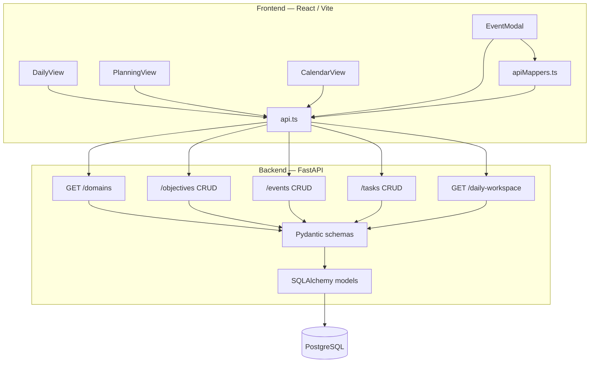
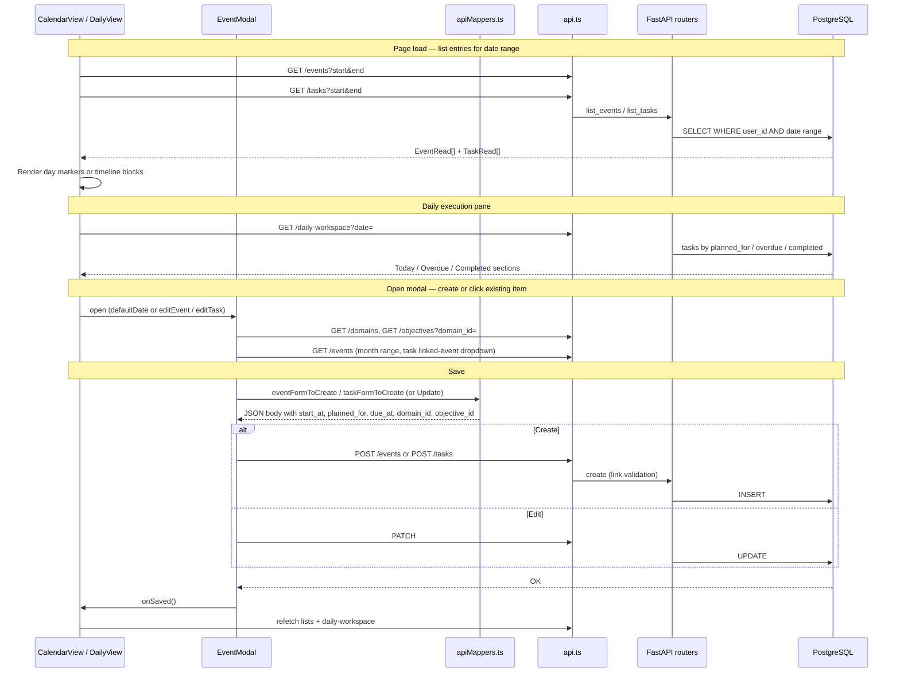
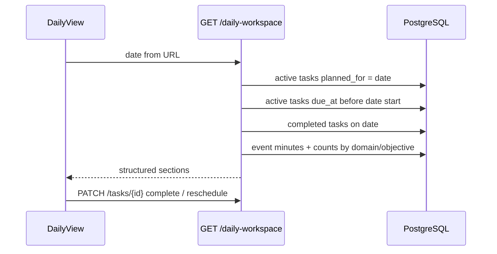

# Data flow

How events, tasks, and objectives move between the React UI, FastAPI API, and PostgreSQL (v0.11.0). Auth uses JWT Bearer tokens (`POST /auth/login`).

## Schema

Entity-relationship reference: [`schema.md`](schema.md).

## Architecture flow

| Layer | Key files |
|-------|-----------|
| Views | `frontend/src/pages/DailyView.tsx`, `PlanningView.tsx`, `CalendarView.tsx` |
| Modal | `frontend/src/modals/EventModal.tsx` |
| Client | `frontend/src/api.ts`, `frontend/src/utils/apiMappers.ts` |
| API | `backend/app/routers/domains.py`, `objectives.py`, `events.py`, `tasks.py`, `daily_workspace.py` |
| Validation | `backend/app/schemas/*.py`, `backend/app/services/link_validation.py` |
| Persistence | `backend/app/models/*.py` |

## CRUD sequence

Typical path when a user opens a view, creates or edits an entry, and sees it reflected in the UI.

## Field mapping (modal → API)

| Modal field | Event API | Task API |
|-------------|-----------|----------|
| `title` | `title` | `name` |
| date + times | `start_at`, `end_at` | `planned_for`, `due_at` |
| `domain` (slug) | `domain_id` | `domain_id` (required) |
| objective select | `objective_id` | `objective_id` |
| `linkedEventId` | — | `event_id` |

## Daily execution (0.11+)

| Route | View |
|-------|------|
| `/` | Daily (timeline + execution pane) |
| `/planning` | Objectives by domain |
| `/daily` | Redirect to `/` |
| `/weekly` | Week timeline |
| `/monthly` | Month grid + schedule import |

## Legacy notes (export only)

Daily and event note **write APIs** and tables remain for migration/export. The UI no longer creates note content.

- `GET/PUT /daily-notes/{date}`
- `GET/PUT /events/{id}/notes`, `GET /events/{id}/series-notes`
- `GET /export/legacy-notes` — JSON bundle for the authenticated user

## Recurrence (0.6+)

Recurring events are stored as one series row; `GET /events` expands occurrences into the requested window.

## Schedule import (0.6+ / PDF 0.8+)

Unchanged — see prior release notes in [`CHANGELOG.md`](../CHANGELOG.md).

## Not wired yet

- PDF OCR for scanned schedules
- Single-occurrence edit/delete for recurring series
- Task/event reminders in the UI
- Obsidian sync and knowledge-graph features (out of product scope)
