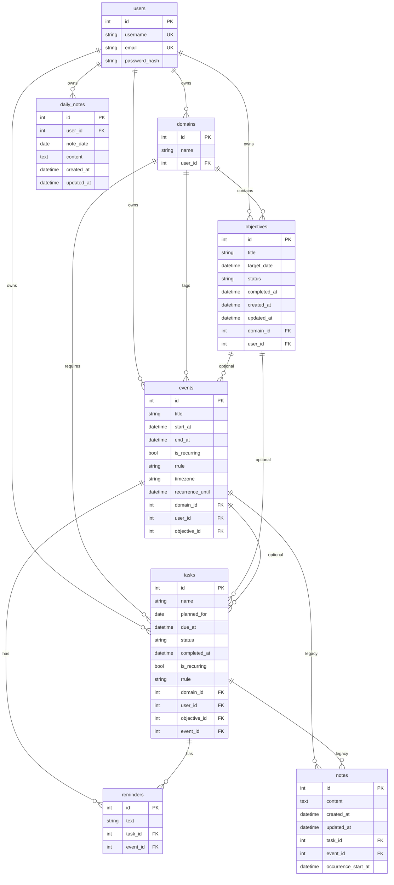

# Database schema (PostgreSQL)

Canonical entity-relationship reference for Palander **v0.11.0** (Alembic revision **007**). Source of truth: SQLAlchemy models in [`backend/app/models/`](../backend/app/models/) and migrations in [`backend/alembic/versions/`](../backend/alembic/versions/).

**Product boundary (0.11):** `daily_notes` and contextual `notes` rows are retained for export (`GET /export/legacy-notes`); the active UI focuses on execution (tasks, events, objectives). Knowledge-style note authoring is out of scope.

## Entity-relationship diagram

## Constraints (not shown in ER diagram)

| Table | Constraint | Rule |
|-------|------------|------|
| `reminders` | `check_reminder_owner` | Exactly one of `task_id` or `event_id` is set |
| `notes` | `check_note_owner` | Exactly one of `task_id` or `event_id` is set |
| `notes` | `uq_notes_event_occurrence` | Unique `(event_id, occurrence_start_at)` for per-occurrence event notes |
| `daily_notes` | `uq_daily_notes_user_date` | One row per `(user_id, note_date)` |

## Objective and task status values

| Entity | `status` values |
|--------|-----------------|
| `objectives` | `active`, `paused`, `completed`, `cancelled` |
| `tasks` | `active`, `completed`, `cancelled` |

## Maintenance

Update this file in the same change set as any Alembic revision that adds, renames, or drops columns or relationships.
