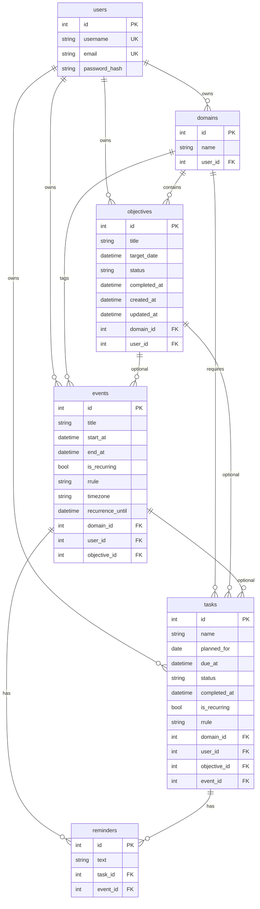

# Database schema (PostgreSQL)

Canonical entity-relationship reference for Palander **v0.12.0** (Alembic revision **008**). Source of truth: SQLAlchemy models in [`backend/app/models/`](../backend/app/models/) and migrations in [`backend/alembic/versions/`](../backend/alembic/versions/).

Legacy `daily_notes` and `notes` tables were removed in revision **008**. Export before upgrading from 0.11: [`legacy-notes-export.md`](legacy-notes-export.md).

## Entity-relationship diagram

## Constraints (not shown in ER diagram)

| Table | Constraint | Rule |
|-------|------------|------|
| `reminders` | `check_reminder_owner` | Exactly one of `task_id` or `event_id` is set |

## Objective and task status values

| Entity | `status` values |
|--------|-----------------|
| `objectives` | `active`, `paused`, `completed`, `cancelled` |
| `tasks` | `active`, `completed`, `cancelled` |

## Recurrence (events)

Stored as `is_recurring`, `rrule` (max 255 chars), `timezone`, and `recurrence_until`. Supported RRULE scopes: `FREQ=DAILY|WEEKLY|MONTHLY` with optional `INTERVAL` and required `UNTIL`; weekly series require `BYDAY`.

## Maintenance

Update this file in the same change set as any Alembic revision that changes columns or relationships.
