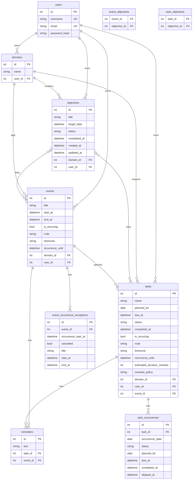

# Database schema (PostgreSQL)

Canonical entity-relationship reference for Palander **v0.13.0** (Alembic revision **009**). Source of truth: SQLAlchemy models in [`backend/app/models/`](../backend/app/models/) and migrations in [`backend/alembic/versions/`](../backend/alembic/versions/).

## Entity-relationship diagram

## Constraints (not shown in ER diagram)

| Table | Constraint | Rule |
|-------|------------|------|
| `reminders` | `check_reminder_owner` | Exactly one of `task_id` or `event_id` is set |
| `task_occurrences` | `uq_task_occurrence_date` | One row per `(task_id, occurrence_date)` |
| `event_occurrence_exceptions` | `uq_event_occurrence_exception` | One row per `(event_id, occurrence_start_at)` |

## Objective and task status values

| Entity | `status` values |
|--------|-----------------|
| `objectives` | `active`, `paused`, `completed`, `cancelled` |
| `tasks` | `active`, `completed`, `cancelled` |
| `task_occurrences` | `active`, `completed`, `cancelled`, `skipped` |

## Recurrence

Events and tasks store RRULE (`DAILY` / `WEEKLY` / `MONTHLY`, optional `INTERVAL`, required `UNTIL`). Events expand virtually; recurring tasks merge RRULE dates with `task_occurrences` for per-date complete/move/skip.

## Maintenance

Update this file in the same change set as any Alembic revision that changes columns or relationships.
